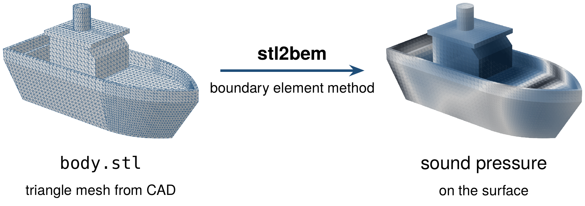
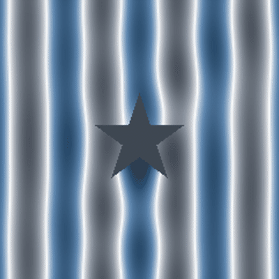
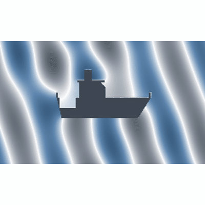
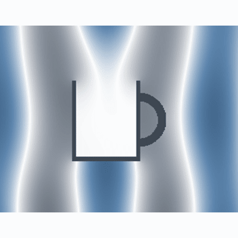
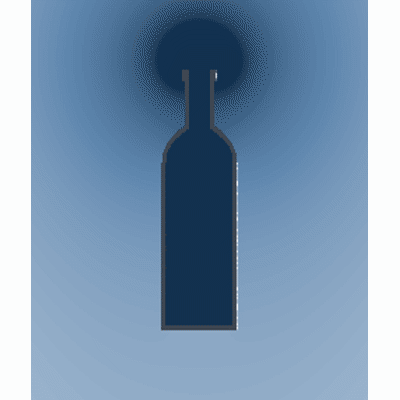
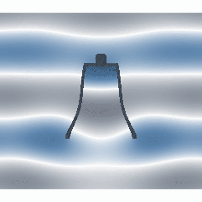
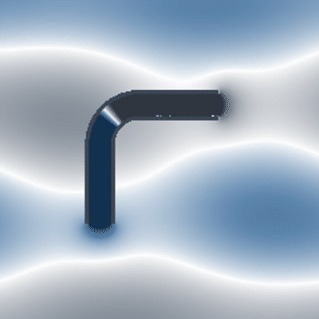
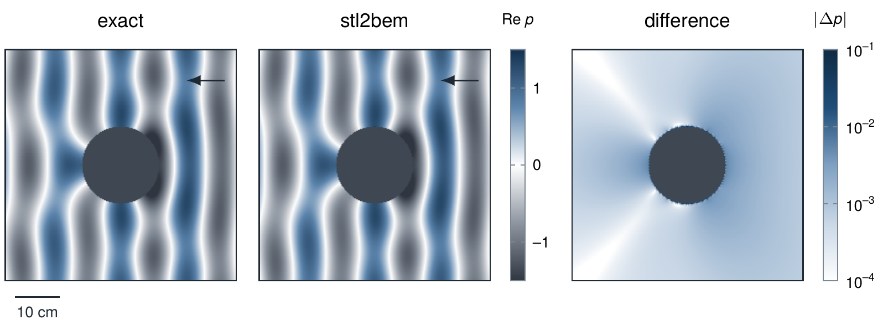
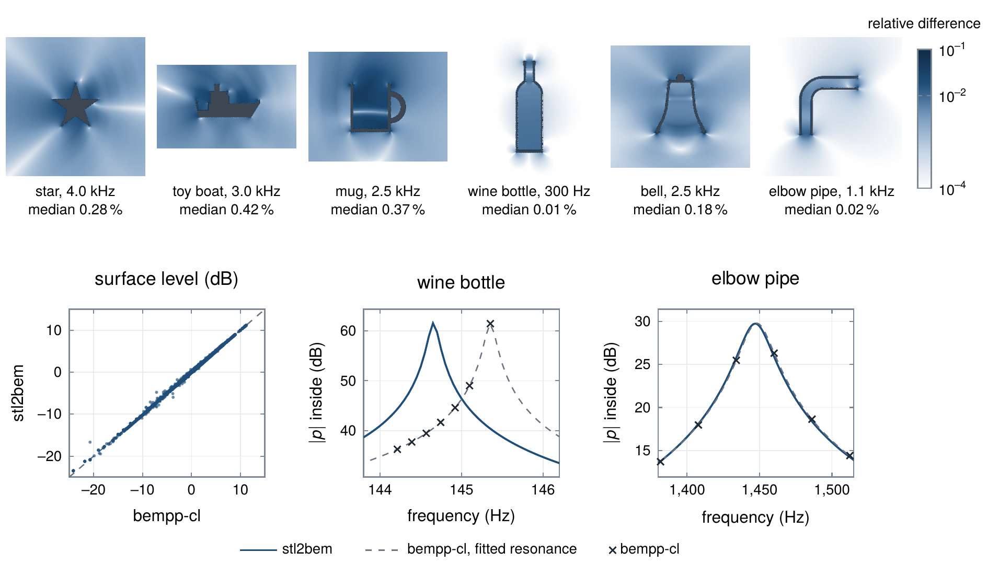

# stl2bem

Computes the sound pressure on and around a rigid object from a closed STL mesh, with the boundary element method.
It runs on a CPU or an NVIDIA GPU and writes tables over directions and frequencies, for example the response of
every microphone on a device, as HDF5 or SOFA files.



<table>
<tr>
<td width="33%"></td>
<td width="33%"></td>
<td width="33%"></td>
</tr>
<tr>
<td align="center">star, 4 kHz</td><td align="center">toy boat, 3 kHz</td><td align="center">mug, 2.5 kHz</td>
</tr>
<tr>
<td></td>
<td></td>
<td></td>
</tr>
<tr>
<td align="center">wine bottle, 144 Hz</td><td align="center">bell, 2.5 kHz</td><td align="center">elbow pipe, 1.4 kHz</td>
</tr>
</table>

Plane waves passing six objects modeled in Fusion (3,800 to 12,000 triangles each): real part of the total
pressure on a slice through each object, over one period. Surface pressure and cavity resonances of the same
objects are in [docs/validation.md](docs/validation.md#gallery).

## Install

```bash
git clone https://github.com/Kwon-Junhyeong/stl2bem
cd stl2bem
pip install .                    # NumPy, SciPy, h5py (CPU)
pip install ".[prep,sofa]"       # optional: merging CAD parts, SOFA export
pip install cupy-cuda12x         # optional GPU backend; pick the CuPy package of your CUDA version
```

## Quick start

```bash
stl2bem --stl device.stl --units mm --mics mics.csv --out out/ --dry_run   # check mesh, microphones, resources
stl2bem --stl device.stl --units mm --mics mics.csv --out out/             # 0-8 kHz, 1-degree direction grid
stl2bem --stl device.stl --units mm --mics mics.csv --out out/ --source_distance 0.5   # sources 0.5 m away
```

`mics.csv` has one `x, y, z` row per microphone, in the STL units; each microphone is moved to the closest point of
the surface. Without `--source_distance` the sources are plane waves (far field). The dry run prints the distance
2D²/λ beyond which that holds for your body; closer sources need `--source_distance`. It also estimates the
run time: the default grid of 65,160 directions takes minutes on a GPU but hours on a CPU, and `--n_el 19`
(10 degrees in elevation) makes a CPU run about eight times faster. `stl2bem --help` lists all options.

From Python:

```python
import numpy as np
from stl2bem import build_mesh, surface_receivers, solve_table, spherical_doa_grid

mesh = build_mesh("device.stl", units="mm", recenter="none")
mics, weights, _ = surface_receivers(np.loadtxt("mics.csv", delimiter=",") / 1000, mesh)
doa, az, el = spherical_doa_grid(360, 19)                 # 1 deg azimuth, 10 deg elevation
freqs = np.linspace(0, 4000, 129)
solve_table(mesh.verts, mesh.tris, mesh.centroids, mesh.normals, mesh.areas, freqs, doa, "table.h5",
            receivers=mics, receiver_elements=weights)
```

The pressure on a plane through the body, as in the gallery:

```python
from stl2bem.viz import plane_grid, field_on_points
pts, shape = plane_grid(center=(0, 0, 0), u=(1, 0, 0), v=(0, 0, 1), half=(0.2, 0.2), n=(241, 241))
field = field_on_points(mesh, 2000.0, doa=(1, 0, 0), points=pts).reshape(shape)   # NaN inside the body
```

The localization error that the body causes for a free-field SRP-PHAT:

```python
from stl2bem.analysis import load_table, free_field, doa_error, summarize
body = load_table("table.h5", elevations=[0])
print(summarize(doa_error(body, free_field(body), band=(300, 3000), method="srp-phat", search="azimuth")))
```

## Output

One HDF5 file per body:

| dataset | shape | meaning |
|---|---|---|
| `p` | (R, D, F) complex64 | total pressure at receiver r for source d at frequency f, relative to the incident pressure at the origin |
| `doa_grid` | (D, 3) | unit vectors towards the sources; az x el grids are stored az-major (`i_az * n_el + i_el`) |
| `source_positions` | (D, 3) | point sources only: their positions (m) |
| `freqs` | (F,) | Hz |
| `positions` | (R, 3) | where `p` is evaluated (m, mesh frame); `centroids` is an older name for the same array |
| `chief_points` | (N_c, 3) | only when CHIEF is used: the interior points |

Attributes hold the mesh report, the solver options and the convention. `--sofa` (or
`python -m stl2bem.sofa table.h5`) also writes the table as a SOFA file (AES69, GeneralTF).

**Convention.** e^{+jωt}, incident wave exp(+jk d·r). For a source signal s(t) from direction d, the FFT/STFT bin
(usual e^{-jωt} kernel) at microphone m is S(ω)·p[m, d, ω], so tables and FFT-domain signals combine directly
without conjugation. The phase reference is the center of the bounding box (`--recenter bbox`); `--recenter none`
keeps the CAD origin.

## Accuracy



Rigid sphere with 5,120 elements at ka = 3.7 against the exact solution: the median difference is 8.6 × 10⁻⁴ of
the incident amplitude. The singular part of the integrals is evaluated exactly, and microphones on the surface are
second-order accurate, also on edges and vertices.



The six gallery meshes solved again with [bempp-cl](https://github.com/bempp/bempp-cl), which uses a different
formulation (Burton-Miller, linear elements): the fields differ by 0.01-0.4 % (median) and the resonance
frequencies by at most 0.5 %. One frequency with 6,840 directions takes 1 s for 4,800 elements and 11 s for
14,700 on an RTX 4060 Ti (8 GB).

Convergence, the comparison with the original code, resonances and timings: [docs/validation.md](docs/validation.md).
Equations and implementation: [docs/method.md](docs/method.md).

## Preparing CAD

The solver needs one closed, consistently oriented surface. A single solid exported from CAD usually is one (all
gallery models are); an assembly usually is not, because its parts overlap. `stl2bem-prep` merges the parts:

```bash
stl2bem-prep chassis.stl board.stl battery.stl --pitch 8 --units mm --out body.stl
```

It voxelizes the parts (pitch = element size), fills enclosed cavities and extracts a closed surface. Features
smaller than the pitch disappear and thin plates become one pitch thick; `--align_z` keeps a flat microphone board
flat. In Fusion, set the maximum edge length of the STL export to about λ/6 at the highest frequency; the mesh
report prints the frequency limit from the mean edge length.

## Limits

* Rigid bodies in free space: no absorption, no vibrating surfaces, no floor or walls.
* Dense matrices: memory grows with the square and time with the cube of the element count, so a few thousand
  elements on a laptop CPU and about 15,000 on an 8 GB GPU.
* CHIEF points need room inside the body. Thin-walled objects (in the gallery, the bottle and the pipe) are solved
  with the CBIE alone, which is safe there: their irregular frequencies start near c / 2t for wall thickness t,
  far above the band the mesh resolves.
* `--formulation burton-miller` is experimental: as accurate as the default away from resonances, but it damps
  sharp cavity resonances. See [docs/method.md](docs/method.md#burton-miller-experimental-option).

## Used in

An earlier version of this solver computed the microphone responses of a robot body in:

* [robot-body-sound-localization](https://github.com/Kwon-Junhyeong/robot-body-sound-localization): direction of
  a speaker from four microphones on a robot body, by matching recordings to the computed responses.
* [calibration-free-sound-localization](https://github.com/Kwon-Junhyeong/calibration-free-sound-localization):
  the same task without calibrating the microphone channels.

## License

MIT (see [LICENSE](LICENSE)).
