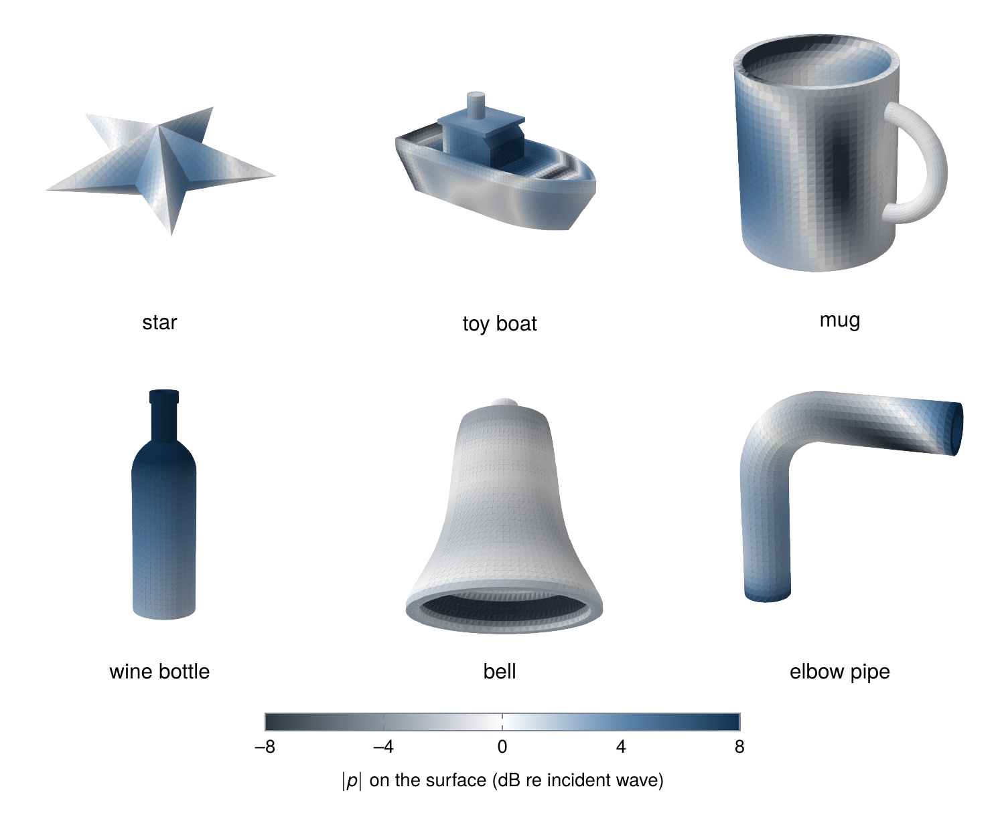
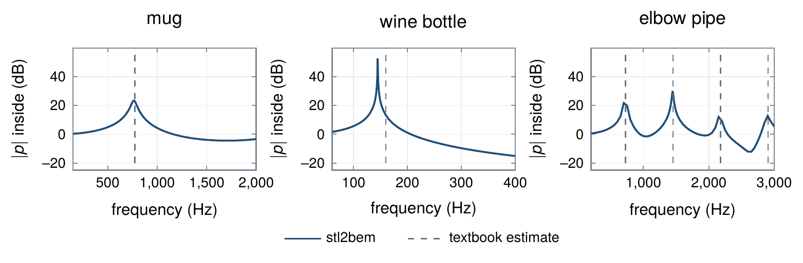
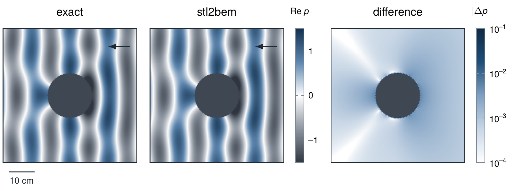
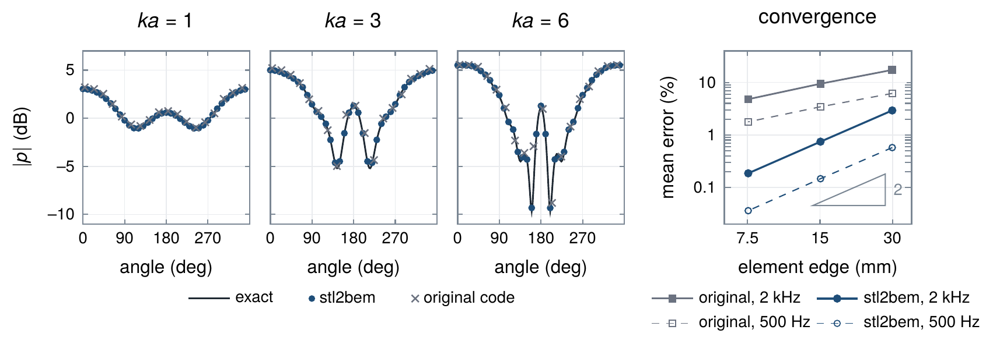
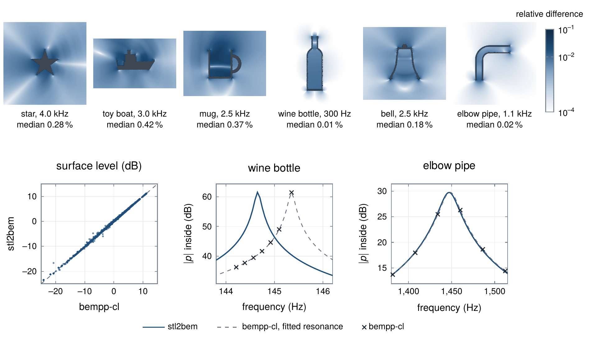
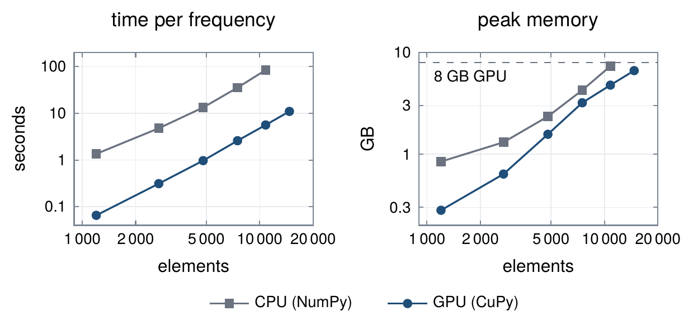

# Validation and results

All numbers and figures on this page are produced by the scripts in [examples](../examples); the figures are drawn
with pgfplots from their data (`bash docs/figures/build.sh`).

## Gallery

Six objects modeled in Fusion and exported as STL in mm ([examples/gallery](../examples/gallery)).

Pressure level on the surface for the waves of the README gallery, relative to the incident wave: louder on the
side facing the source, quieter in the shadow, strongly shaped by cavities. This is the level a microphone on the
surface would measure.

Pressure at a point inside the hollow objects over frequency. The resonances follow from the geometry alone and
agree with simple estimates:

| object | stl2bem | estimate |
|---|---|---|
| mug (closed at the bottom) | 764 Hz | 775 Hz, quarter-wave resonance with end correction |
| wine bottle | 144.5 Hz | about 160 Hz, Helmholtz resonator (crude neck model) |
| elbow pipe (open at both ends) | 727, 1445, 2180, 2900 Hz | n × 727 Hz, open pipe with end corrections |

## Rigid sphere against the exact solution

A rigid sphere has an exact series solution. The sphere is written to an STL file in mm and read back like any
other model ([examples/validation_sphere](../examples/validation_sphere), numbers in its `results.md`).

Exact solution, stl2bem and their difference (5,120 elements, ka = 3.7, 53,062 grid points). The median difference
is 8.6 × 10⁻⁴ of the incident amplitude and 99.8 % of the points are below 10⁻². The largest differences, up to
0.94, are at the 118 points within 1 mm of the sphere: the field formula used for the map does not hold on the
surface itself, which is why microphones on the surface use a corrected formula (next figure). From 2 mm, a quarter
of an element, outward the largest difference is 0.015.

Left: pressure on the surface around the equator (1,280 elements). Right: mean error on the surface against the
element size, which falls with its square. "Original" is the unreleased code stl2bem grew from: one-point kernel
integration, values taken at the nearest element centroid.

| elements | edge | original, 500 Hz | stl2bem, 500 Hz | original, 2 kHz | stl2bem, 2 kHz |
|---|---|---|---|---|---|
| 320 | 30 mm | 6.19 % | 0.57 % | 17.3 % | 2.93 % |
| 1,280 | 15 mm | 3.44 % | 0.15 % | 9.46 % | 0.74 % |
| 5,120 | 7.5 mm | 1.78 % | 0.036 % | 4.79 % | 0.19 % |

## Gallery against bempp-cl

The gallery meshes are solved again with [bempp-cl](https://github.com/bempp/bempp-cl), an independent BEM library,
with a different formulation: Burton-Miller with continuous piecewise-linear elements instead of CBIE + CHIEF with
constant elements. Same triangles, frequency and direction
([examples/crosscheck_bempp](../examples/crosscheck_bempp)).

Top: difference of the field on the gallery slices, |p - p_bempp| / max(|p_bempp|, 1), where 1 is the incident
amplitude. The median is 0.01-0.4 %; the largest differences are at sharp corners and edges, where the field changes
fastest and the two kinds of elements differ most. Surface levels agree to 0.003-0.08 dB (median per object).

Bottom right: the two resonators. Near a sharp resonance a small frequency shift changes the amplitude many times,
so they are compared by the fitted resonance frequency, half width and peak level, and their field maps are taken
off resonance (bottle 300 Hz, pipe 1.1 kHz).

| resonance | stl2bem | bempp-cl |
|---|---|---|
| wine bottle (Helmholtz) | 144.66 Hz, half width 0.061 Hz, 61.6 dB | 145.35 Hz, half width 0.063 Hz, 61.4 dB |
| elbow pipe (2nd mode) | 1447.0 Hz, half width 10.8 Hz, 29.8 dB | 1448.0 Hz, half width 10.8 Hz, 29.9 dB |

These sweeps are finer than the gallery's (0.5 Hz and 5 Hz steps), hence 144.66 Hz and 1447.0 Hz instead of
144.5 Hz and 1445 Hz. The bottle resonance is set by its neck, only a few elements across on this mesh; the two
discretizations place it 0.5 % apart, with the same width and height.

The experimental Burton-Miller option of stl2bem is compared on the same data in
[method.md](method.md#burton-miller-experimental-option).

## Performance

Time and peak memory per frequency for a box with 8 microphones and 6,840 plane-wave directions (1 degree in
azimuth, 10 degrees in elevation), assembly included ([examples/benchmark](../examples/benchmark)). GPU: RTX 4060
Ti 8 GB. CPU: Intel Core i5-13500 (20 threads), NumPy/SciPy.

| elements | GPU time | GPU memory | CPU time | CPU memory |
|---|---|---|---|---|
| 1,200 | 0.07 s | 0.3 GB | 1.4 s | 0.8 GB |
| 4,800 | 1.0 s | 1.6 GB | 13 s | 2.4 GB |
| 10,800 | 5.6 s | 4.8 GB | 85 s | 7.4 GB |
| 14,700 | 11 s | 6.7 GB | not run | |
